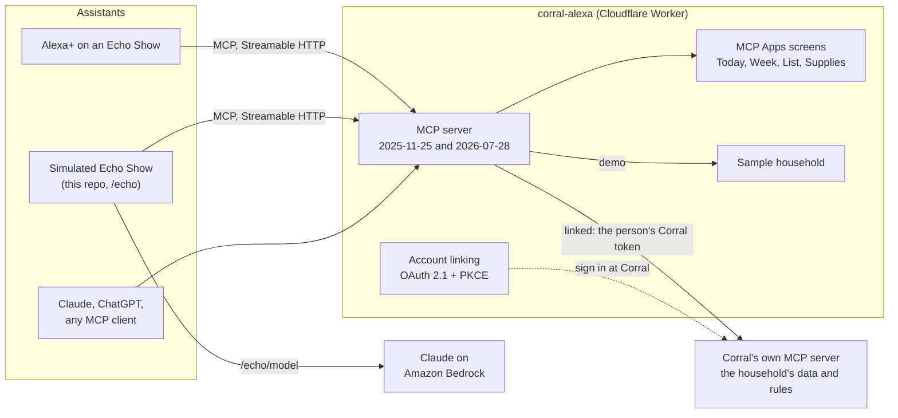

# Corral for Alexa+

Alexa can set a timer. It can't tell you whether it's Dad's weekend, who has the 4:00 pickup, whether the dog got her pill, or that you're down to two bags of horse feed. [Corral](https://corral.narralogy.ai) can. It's the household platform one family and ranch run on every day: the shared calendar, chores and who did them, shopping lists, where everyone is, kids' points, and supplies.

**Corral for Alexa+** puts that household inside Alexa+. It's a self-hosted MCP server (spec 2025-11-25, Streamable HTTP) on Cloudflare Workers that gives Alexa+ Corral's tools, draws interactive screens for the Echo Show with [MCP Apps](https://modelcontextprotocol.io/extensions/apps), and links each Alexa account to Corral with OAuth 2.1, so every family's rules come along: private events stay private, a kid's change waits for a parent, and the farm hand only hears about the ranch.

**Try it**

- **[The simulated Echo Show](https://alexa-demo.corral.narralogy.ai/echo)**: talk to it (or type), watch it call Corral's tools over MCP, tap the screens. It runs on a made-up household, Juniper Hollow. The demo passcode is in the submission's testing instructions.
- **The MCP server**: `https://alexa-demo.corral.narralogy.ai/mcp` (the sample household, open) and `https://alexa.corral.narralogy.ai/mcp` (linked to a real Corral, behind account linking).
- **The Agent Skill**: [`skills/corral-household`](skills/corral-household/SKILL.md), also served as the MCP prompt `household-assistant`.

## What it does

| Ask | What happens |
|---|---|
| "What's going on today?" | The **Today** screen: the calendar with what's on now and next, chores to tap off, and who's where. It keeps itself current. |
| "What's our weekend look like?" | The **Week** screen: seven days, today marked, who's driving. |
| "Leo emptied the dishwasher." | The chore is checked off with credit to Leo, and the screen updates. |
| "We're down to two bags of horse feed." | The count is recorded, the **Supplies** screen shows about three days left, and it offers to put feed on the feed store list. |
| "Add tortillas and salsa." | Both go on the grocery list; the **List** screen shows it, and tapping an item checks it off. |
| "Put the dentist on Thursday at 3:30 for Leo." | It confirms first. From a shared kitchen device the event goes to a parent to approve, and it says who. |
| (tapping a chore on the screen) | The screen checks it off through Corral and tells the assistant, so "who did the eggs?" right after has the answer. |

## How it works



- **The rules travel with the data.** The bridge never decides who sees or changes what. Linked, every call goes to Corral's own MCP server with the person's own Corral token, and Corral applies the same rules as its app. The sample household answers the same tools with the same JSON, so everything here runs and demos with no account.
- **One server, every assistant.** Alexa+ speaks MCP 2025-11-25; current clients speak 2026-07-28. Both are served statelessly from one endpoint with the MCP TypeScript SDK's `createMcpHandler`, so the same server, screens and skill also work in Claude, ChatGPT or Home Assistant.

## Built for Alexa+

The real Alexa+ developer tools (the MCP Toolkit, the `alexa-ai` CLI and the web simulator) are open only to select partners, so hackathon entrants can't connect a server to a real Alexa+ ([hackathon FAQ](https://amazonappdev2026.devpost.com/details/faqs)). This server is built to the published Alexa+ contract anyway, so it's ready the day access opens:

| Alexa+ requirement | Here |
|---|---|
| Self-hosted MCP server, spec 2025-11-25, Streamable HTTP | Yes, plus 2026-07-28 for current clients |
| Round trips under 500 ms | Tool calls answer in about 10 to 20 ms from the edge on the sample household; linked to a real Corral at home, 120 to 350 ms measured end to end |
| Visuals through MCP Apps | Four screens, each one self-contained HTML (`text/html;profile=mcp-app`) that declares it reaches no other origin |
| OAuth 2.1 authorization code with PKCE (S256) | Yes ([account linking](#account-linking)) |
| Protected resource metadata at `/.well-known/oauth-protected-resource` | Served at the root, naming `/mcp`, this server and the scopes |
| `resource` on authorize and token; a refresh token with every access token | Yes |
| No dynamic client registration; a fixed client | Alexa's client is made once through `/admin/clients`; nothing else can register |
| 401 without `WWW-Authenticate` | `/mcp` answers a bare 401 before linking |
| Tools designed for one-shot extraction and voice | Short, specific descriptions; read tools default to today; changes answer `done` or `waiting_for_approval` with who approves |

## The simulated Echo Show

[`/echo`](https://alexa-demo.corral.narralogy.ai/echo) stands in for Alexa+ on an Echo Show 8, as the FAQ invites: **the page is a real MCP client** of this server. It sends `initialize`, `tools/list`, `resources/read` and `tools/call` over Streamable HTTP, and shows every call in a live traffic log beside the device.

- **Listening and speaking:** push-to-talk, or hands-free after "Alexa", with the browser's speech recognition and voices. Typing works everywhere.
- **Deciding:** Claude on Amazon Bedrock (below) picks the tools and says the answer. The page runs the loop: it calls the tools Claude asks for, sends the results back together, and stops at an answer.
- **Screens:** when a tool has an MCP Apps screen, the page renders it on the device as a host would, passes taps back through MCP, and tells Claude what was tapped.
- **The light bar** shows listening, thinking and speaking; captions show what it heard and what it said.

## AWS: Claude on Amazon Bedrock

The simulator's brain is **Claude Opus 5.5 on Amazon Bedrock** (`anthropic.claude-opus-5-5`), called from the Worker at `POST /echo/model`:

- **Endpoint and auth:** Bedrock's Messages API endpoint, `https://bedrock-mantle.{region}.api.aws/anthropic`, with a Bedrock API key as the bearer, through the official Anthropic TypeScript SDK. No AWS request signing is needed, which keeps it Workers-friendly. The key is a Worker secret and never reaches the browser.
- **Prompt:** a fixed voice-assistant prompt plus the household Agent Skill, marked for prompt caching, then the household's time zone and the current time. Tools are the MCP server's own, as the page listed them.
- **Speed:** low effort, for quick spoken replies.
- **Resilience:** if the main model declines a request, the SDK's refusal-fallback middleware runs it again on Claude Opus 4.8.
- **Cost control:** a per-visitor rate limit (a Workers rate-limit binding), an optional demo passcode, and caps on conversation and tool-list size, so it can't be used as a free general chatbot.
- `src/echo/model.ts` is the whole integration; `test/echo.test.ts` checks the request it sends.

## The Agent Skill

[`skills/corral-household`](skills/corral-household/SKILL.md) is an [Agent Skill](https://agentskills.io/) that teaches any agent to run a family's day through Corral's tools by voice: look before changing, confirm in one sentence, respect approvals, keep "Busy" private, credit the right person, speak briefly, and use the screens. It includes everyday requests, a running-low recipe and a tool reference. The server also offers it as the MCP prompt `household-assistant`, and the simulator gives it to Claude.

## Account linking

In linked mode this server is an OAuth 2.1 authorization server for Alexa+, and Corral is where people sign in:

```
Alexa app --> /authorize --> Corral's consent page --> /callback --> back to Alexa with a code --> /token
              (this server)   sign in, pick the household,  (this server keeps Corral's
                              choose what to allow           tokens, encrypted)
```

- **Corral behind it.** `/authorize` hands the person to Corral's consent page as this server's own Corral client (registered with Corral once, automatically), with PKCE and Corral's MCP server as the resource. The `state` is bound to the browser, so a code can't be finished somewhere else.
- **Tokens.** Corral's tokens live inside the grant, encrypted. Alexa's access token lasts as long as the Corral token behind it; when Alexa refreshes, this server refreshes Corral's too. If someone disconnects the app in Corral, the link ends and Alexa asks to link again.
- **Built on** Cloudflare's [`workers-oauth-provider`](https://github.com/cloudflare/workers-oauth-provider): tokens, codes and secrets are stored only as hashes, props are encrypted, and refresh tokens rotate.
- **Proven end to end** against a real Corral: sign-in, consent, code exchange, tool calls with the person's token, and refresh.

### Linking a real Alexa+ (once partner access exists)

1. Set the admin secret once: `pnpm exec wrangler secret put ADMIN_TOKEN --env production` (24 characters or more).
2. Make Alexa's client: `ADMIN_TOKEN=... pnpm alexa:client create https://alexa.corral.narralogy.ai`. Keep the secret it prints; it isn't shown again.
3. Point Alexa at it: `alexa-ai configure-account-linking --addon-id <id> --stage development --client-id <client_id>`, with the secret in `ALEXA_CLIENT_SECRET`, and `https://alexa.corral.narralogy.ai/mcp` as the add-on's MCP endpoint.
4. Give the redirect addresses the CLI shows back to the client: `ADMIN_TOKEN=... pnpm alexa:client redirects https://alexa.corral.narralogy.ai <client_id> <address> ...`, then `alexa-ai deploy`.

## Run it locally

Needs Node 22 and pnpm 9.

```bash
pnpm install
pnpm dev
```

That builds the screens and starts the Worker at `http://127.0.0.1:8795` with the sample household:

- `/echo` is the simulated Echo Show. With no Bedrock key, run `pnpm dev --var MODEL_MOCK:true` to answer with a small practice model, or put `BEDROCK_API_KEY` in `.dev.vars`.
- `/mcp` is the MCP server; point any MCP client at it (for example `npx @modelcontextprotocol/inspector`).
- `/preview` shows any screen in Echo Show 5, 8 and 15 and phone frames, light or dark.
- `pnpm smoke [url]` talks to a running server the way Alexa+ does and prints timings.

## Deploy

Deploys always name an environment, so the sample household can never replace the linked bridge:

| Script | Worker | Address | Answers from |
|---|---|---|---|
| `pnpm ship` | `corral-alexa` | `https://alexa.corral.narralogy.ai` | A real Corral, after account linking |
| `pnpm ship:demo` | `corral-alexa-demo` | `https://alexa-demo.corral.narralogy.ai` | The sample household, with `/echo` and `/preview` |

The demo's simulator needs `BEDROCK_API_KEY` (and optionally `DEMO_PASSCODE`) as Worker secrets. To run your own, change the hostnames, `CORRAL_URL` and the KV id in `wrangler.jsonc`.

## Tests

```bash
pnpm check
```

Builds every page, typechecks (Worker and screens), and runs the tests:

- the sample household's answers;
- the 2025-11-25 handshake, tools and prompts Alexa+ sees;
- every screen's resource;
- the current protocol for up-to-date clients;
- account linking end to end against a stand-in Corral (discovery, the hand-off to Corral's sign-in, code and token exchange, calls with the person's token, refresh, revoked access, a declined sign-in, a callback in another browser, an unknown redirect address, the admin route);
- the simulator's model route (what it sends to Bedrock, the rate limit, the passcode, size caps).

## Layout

| Path | What |
|---|---|
| `src/index.ts` | The Worker: the sample household with `/echo` and `/preview`, or account linking in front of a real Corral |
| `src/server.ts` | The MCP server: Corral's tools, the screen tools and their MCP Apps resources, the skill as a prompt |
| `src/household.ts`, `src/corral.ts`, `src/sample/` | The contract both households answer; a real Corral through its MCP server; the sample household |
| `src/today.ts`, `src/screens.ts` | What each screen shows |
| `src/link/` | Account linking: the OAuth provider, Corral as the sign-in, `/admin/clients` |
| `src/echo/` | The simulator's model route (Claude on Bedrock) and the practice model |
| `widgets/` | The screens (MCP Apps), each built into one HTML file, on `widgets/shared` |
| `echo/`, `preview/` | The simulated Echo Show and the screen preview |
| `skills/corral-household/` | The Agent Skill |
| `docs/feedback.md` | Product feedback and the friction log |

## License

MIT. See [LICENSE](LICENSE).
